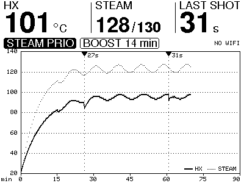
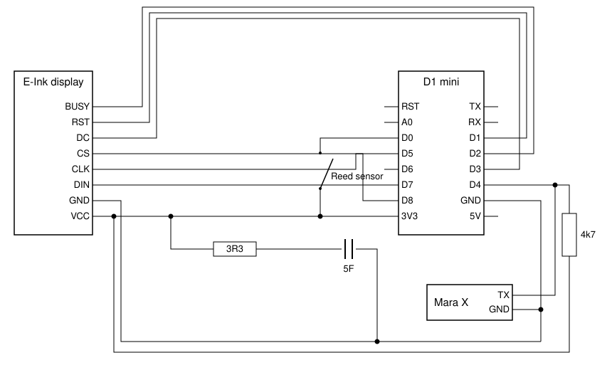
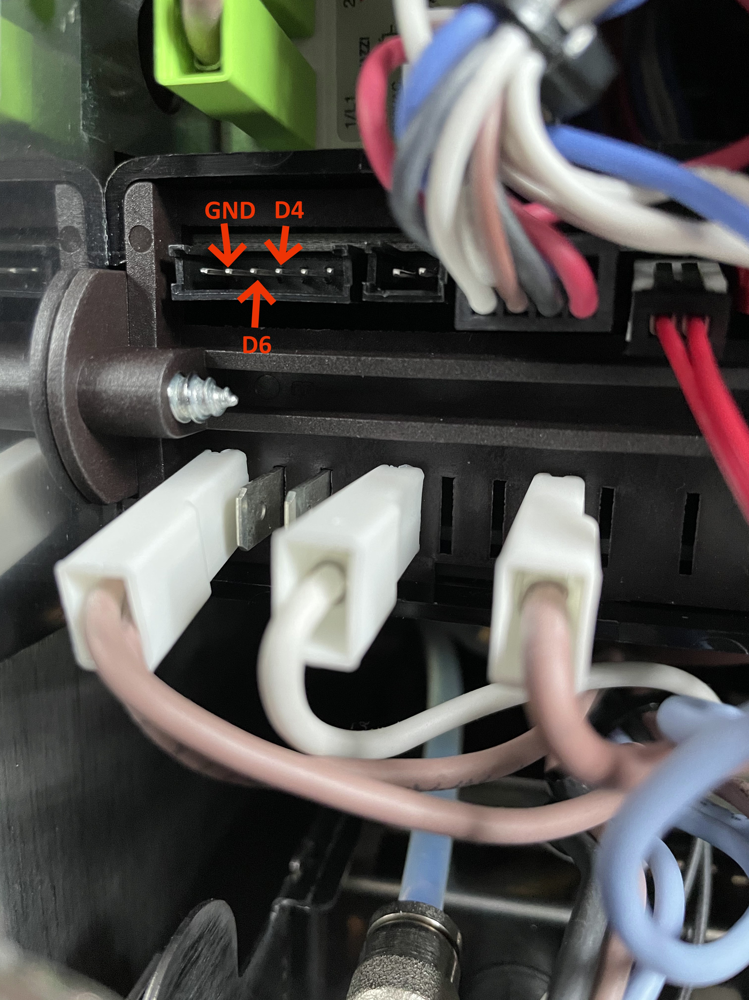
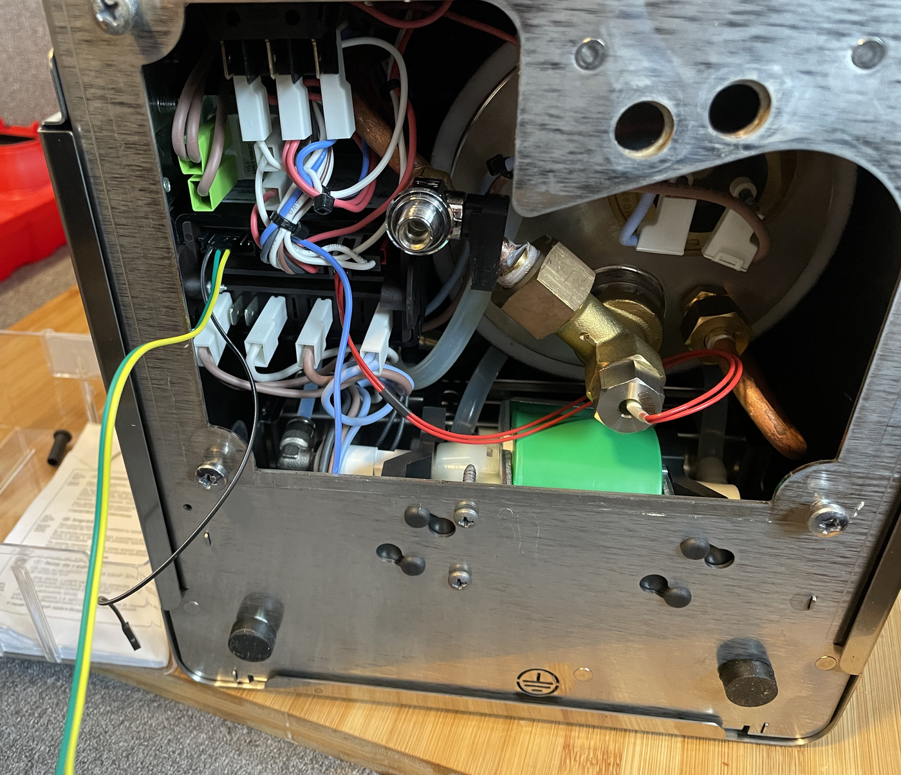

# Mara X Meter

The [Lelit Mara X](https://marax.lelit.com/) is a heat exchanger (hx) espresso machine. It has received a lot of attention, as it has two different modes of operation and due to that has more sensors than an usual hx espresso machine. Several resources on the internet showed that one can extract data of the sensors via a serial connection.

With this project you can visualize the read data on an e-ink display and even automatically start a shot timer.



> This is the desktop preview of the dashboard (see [Development](#development)), showing a session of 70 minutes with two shots.

## Motivation

Pulling a perfect espresso (often referred to as a god shot) requires a lot of patience and trial and error. Several parameter come into play for a perfect cup of coffee. Two of those factors with an espresso machine are the brewing temperature and the extraction time (or shot time).

Since the machine enables access to the current heat exchanger temperature (among others), I wanted to visualize it on a display and try to find a way to extract the pump running time, which indicates the shot time.

Some inspiration for this project:

- [Lelit Insider](https://www.youtube.com/watch?v=9NL6yeq7sMM): This is probably the origin of most mara-x modifications including the data extraction. It shows how the connection to the mara-x can be done with a laptop.
- [This reddit post](https://www.reddit.com/r/espresso/comments/hft5zv/data_visualisation_lelit_marax_mod/) shows how a mara-x owner extracts the data, stores it to a database and visualizes it.
- [Another github repository](https://github.com/alexrus/marax_timer) shows how the data is visualized on an oled display and also includes, how the shot timer is triggered by extracting the pump running state. Here I got the inspiration for the shot timer solution.

Since I wanted the shot timer and the graphs, I decided to create my own project. To reduce the visual impact on the looks of the espresso machine, I decided to go with an e-ink display.

## Solution

Similar to my [coffee grinder automation](https://github.com/Jerey/coffee-automation), I again chose an D1 mini as basis for this project. It is used to read the data from the espresso machine and visualize it on the display. Because of that, you can connect to it via wifi and therefore flash it over the air (OTA).

Here you can see a sample video taken while the mara-x was heating up, with an earlier version of the dashboard.


> This video was taken over the course of 30 minutes.

### What the display shows

- **HX**: the current heat exchanger temperature. This is the number that matters for the shot, so it is the biggest one.
- **STEAM**: the steam boiler temperature and, behind the slash, its target.
- **SHOT**: the shot timer in seconds while the pump runs. After the shot, the length of the last shot stays there. Pump runs shorter than 15 seconds are ignored, since that is the machine refreshing the water in the hx or a backflush and not me pulling a shot.
- The badges show, whether the machine is in steam priority (coffee priority is the normal case and gets no badge), whether the heating is on, the boost countdown after a shot and the wifi state with the IP address for flashing.
- If the D1 mini did not start from a power on (crash, watchdog, a dip of the supply), a small `RESET` note with the reason appears next to the wifi state until the next power cycle. Helpful, since the serial monitor is usually not connected in the kitchen.
- The graph shows the hx (solid) and the steam (dotted) temperature over time. Every shot is marked with a triangle and its length. The time axis starts with 30 minutes and widens in steps up to three hours, so the whole session stays visible.

The panel is refreshed partially whenever a value changed (that takes about half a second) and fully every ten minutes to get rid of ghosting.

While the meter starts and after it is switched off, the panel shows the logo. It is drawn a bit differently every time: it sits somewhere else, is sliced into shifted (sometimes inverted) bands and gets some random scan lines, so no pixel sees the same picture for days.


## Workflow

My mara x is connected to a wifi controlled power outlet. Whenever I want a coffee, I switch it on and after I am done making my coffee, I switch the outlet off. Since e-ink displays have to be shutdown properly to avoid pixel burn, the D1 mini has to survive around 5s after loosing power to do that. Since batteries usually have a to big capacity for that and are also limited in number of charging cycles, I looked into supercapacitors after [Oliver Ju](https://github.com/helmo2004) suggested those.

## Setup

To build this project, following parts are needed:

- D1 mini
- A reed sensor
- An e-ink display (I chose the Waveshare 4.2 module with two colors)
- A mara-x
- A supercapacitor (~ 5F or bigger)
- A resistor (~ 5Ω) for the supercapacitor
- A resistor (~ 4.7kΩ) as pull-up for the data line

> I used two supercapacitors with 2.7V and 10F in Series - as this results in a higher voltage capability (up to 5.4V) - but therefore also a smaller capacity (5F).

### Wiring

Following you can see a schematic for the wiring of the D1 mini.



Only the TX line of the mara-x is needed, the machine never listens to us.

Here is a picture to know, what to connect where at the mara-x:



Here another picture further away:



#### Reed sensor

The reed sensor is glued onto the vibration pump. Ensure, that you can read `0`'s and `1`'s while activating the pump from the reed sensor. I had to look for a good position to receive any values. See also [Alex Rus](https://github.com/alexrus/marax_timer) repository, who has a picture of the reed sensor on the pump.

Since the signal has gaps while the pump runs, the shot timer only stops after the sensor stayed quiet for 1.5 seconds.

#### Supercapacitor

The capacitor between 3.3V and ground is needed to properly switch off the e-ink display to avoid pixel burn. Whenever the D1 mini recognizes a power loss, it will automatically shutdown the display: two full refreshes to white against the ghosting, then the logo. During the first minute after switching on, the capacitor is still charging and the detection is off. Should the power come back after a shutdown (or the detection be wrong), the D1 mini restarts by itself. The resistor is needed to limit the current consumed by the capacitor (which have a very low [ESR](https://en.wikipedia.org/wiki/Equivalent_series_resistance) of 60mΩ each - so in total 120mΩ), as the D1 mini otherwise will not switch on. Depending on your setup, this value may vary.

#### Pull-up on the data line

D4 is one of the boot pins of the ESP8266: if it is low while the D1 mini starts, it does not boot at all. The machine's serial line idles high once the machine runs, but it is low while the machine's controller starts up and while the machine is off. So switching on is a race between the machine's controller and the D1 mini, and flashing via usb with the machine off cannot work at all. For five years the D1 mini lost nothing, probably because the empty supercapacitor held the 3.3V rail down for a moment every morning and the D1 mini started late. A supercapacitor loses capacity with age and charges faster, and one morning the D1 mini was too early. A resistor of about 4.7kΩ between D4 and 3V3 ends the race. It does not disturb the data and cannot harm anything, so just add it.

> I learned this the hard way, after the meter stopped booting one morning after five years. The pull-up should have been there from the first day. So if nothing happens at all, have a look at the boot message on the serial monitor first.

### Flashing

Initially you will have to flash the software to the D1 mini via usb (`pio run -e d1_mini_usb -t upload`). The dashboard works right away, with or without wifi. If no known wifi is found, the D1 mini opens up an access point (`MaraXMonitor`, the password can be found in the code) for three minutes. After connecting to it, a wifi configuration page will pop up and you can connect the D1 mini to your wifi. From then on, the D1 mini will automatically connect to your wifi, if available, and you can flash it over the air (`pio run -e d1_mini_ota -t upload`).

The project is built with [platform io](https://docs.platformio.org/en/latest/core/index.html). You can find installation information there.

> It can happen, that you have to specify the `upload_port` in the `platformio.ini`.

The serial output (`pio device monitor`, 74880 baud, the same rate the ESP8266 uses for its boot messages) shows every line received from the machine and what the shot timer and the wifi are doing. Quite handy while wiring everything up.

## Development

The code is split into small libraries in `lib/`:

- `MaraXProtocol`: assembles and parses the serial lines of the machine.
- `ShotTimer`: turns the pulses of the reed sensor into a shot timer.
- `History`: ring buffer of temperatures and shots plus the maths of the graph axes.
- `PowerMonitor`: decides from the supply voltage, whether the power was cut.
- `Display`: the dashboard and logo painters (plain Adafruit GFX) and the glue to the e-paper driver (GxEPD2).

The first four know nothing about the hardware and are unit tested on the host. The same two commands as in the CI check the formatting (`.clang-format`) and run cppcheck over `src/` and `lib/`:

```sh
pio test -e native
clang-format --dry-run -Werror src/*.cpp lib/*/*.cpp lib/*/*.hpp test/*/*.cpp tools/preview/preview.cpp
pio check -e d1_mini_usb
```

The dashboard and the logo can be rendered on the desktop without any hardware. The script builds the painters against Adafruit GFX with a tiny Arduino stand in and writes PNG files for a few sample situations into `tools/preview/out/`. This is how the pictures in this readme were made.

```sh
tools/preview/build.sh
```

The logo artwork in `lib/Display/LogoImage.h` is generated with `tools/make_logo.py` (needs Pillow). The random placement and glitching happens on the D1 mini.

The schematic (svg and drawio) is drawn by `tools/make_schematic.py`, so the wiring table above and the picture cannot drift apart.

## Further ideas

This project has several parts, which can be extended. Here are some ideas, I might extend one day, but for now I am happy with the current state.

### Shot timer from pump switch

The reed sensor alters between 1's and 0's while the pump is running. Therefore one has to wait for a certain time, until the pump off is certain. Further, the pump sometimes is activated by the machine itself to exchange the water in the HX.

To get a more precise shot timer, one could check, whether it is possible to "listen" to the shot lever directly. Newer firmware of the mara-x sends the pump state as seventh value, which the parser already understands.

### Mqtt, NodeRed, Grafana and InfluxDB

Since I already have a Mqtt, NodeRed, Grafana and an InfluxDB up and running, it would be rather straight forward to publish the data via the network and visualize it in Grafana. This could be useful in a few cases:

- By publishing the data, one could configure a notification, when a certain HX temperature has been reached and been stable for a given time.
- One could automatically create a table to rate the shots. The given HX temperature with the shot timer could be used as reference.
